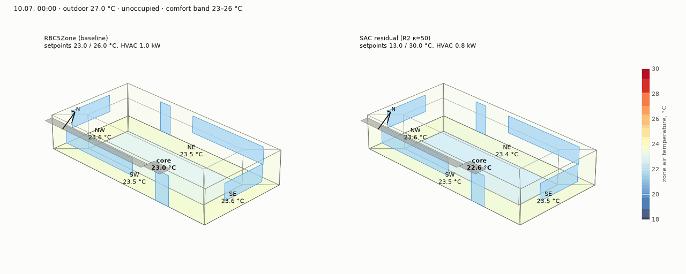
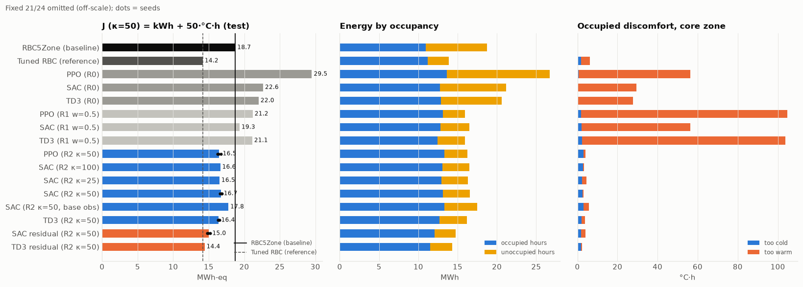

# HVAC Control with Deep RL: Reward Design

Учебный проект: агенты SAC, PPO и TD3 каждые 15 минут выставляют уставки отопления и охлаждения пятизонного офиса в симуляции EnergyPlus через [Sinergym](https://github.com/ugr-sail/sinergym). Главная цель - понять, как функция награды определяет поведение агента, и проверить, может ли DRL обойти штатный контроллер RBC5Zone.



*Летний будний день по часам: слева штатный контроллер, справа RL-агент; зоны окрашены по температуре воздуха.*

## Функции награды

```text
R0:  встроенная LinearReward Sinergym (энергия + дискомфорт круглосуточно)
R1:  r = -[ w * P/P_ref + (1-w) * occ * dT/dT_ref + lambda * |da| ]
R2:  r = -[ P/P_ref + (kappa/4.3) * occ * dT/dT_ref + 0.2 * |da| ]
```

`P` - мощность HVAC (`P_ref` = 2.15 кВт), `dT` - выход температуры ядра за полосу комфорта (`dT_ref` = 0.5 °C), `occ` — есть ли люди в здании, `|da|` - изменение уставок.

- **R0** штрафует дискомфорт и в пустом здании, поэтому запрещает самый дешёвый способ экономии — ночное снижение уставок.
- **R1** при `w` = 0.5 оценивает 1 °C·ч дискомфорта всего в 4.3 кВт·ч: комфорт почти бесплатен.
- **R2** задаёт цену дискомфорта явно, κ = 50 кВт·ч за °C·ч, и совпадает с итоговой метрикой J = кВт·ч + 50 · °C·ч.

## Результаты

Тестовый год, жаркий климат; «±» — стандартное отклонение по 3 seed.

| Контроллер | Энергия, МВт·ч | Дискомфорт, °C·ч | J |
| --- | ---: | ---: | ---: |
| RBC5Zone (бейслайн) | 18.74 | 0.05 | 18.74 |
| Агенты на R0 | 20.6–26.7 | 28–56 | 22.0–29.5 |
| Агенты на R1 | 15.9–16.5 | 56–105 | 19.3–21.2 |
| **Агенты на R2** | **16.2–16.6** | **3–4** | **16.4–16.7** |
| **Residual-агенты на R2** | **14.3–14.8** | **2–4** | **14.4–15.0** |
| Настроенный RBC (референс) | 13.85 | 6.25 | 14.16 |



- **Награда важнее алгоритма.** С R0 агенты тратят на 10–42 % больше бейслайна, с R2 те же алгоритмы экономят 12–14 % энергии почти без дискомфорта. На R2 SAC, PPO и TD3 отличаются не более чем на 2 %.
- **R2 ранжирует контроллеры так же, как KPI** (Spearman ρ = 1.0), встроенная R0 — нет (ρ = −0.14).
- **Перенос на другие климаты:** без дообучения агенты на R2 обходят RBC5Zone на 29–57 % по J в климатах mixed и cool, но не выучили предпрогрев после ночного снижения.
- **Простое настроенное правило всё ещё немного лучше** (лучший агент отстаёт на 1.8 % по J). Основные потери агентов — летнее переохлаждение и «дёргающиеся» уставки.

## Запуск

Python 3.12, Sinergym 3.12.2, EnergyPlus 25.1.0 (версии Sinergym и EnergyPlus должны совпадать).

```bash
pip install "sinergym[drl]==3.12.2" matplotlib ipykernel
export EPLUS_PATH=/path/to/EnergyPlus-25-1-0 PYTHONPATH=/path/to/EnergyPlus-25-1-0
python check_env.py

python scripts/run_baselines.py
bash scripts/launch_v2.sh 6 configs/jobs_v2.txt
python scripts/evaluate_v2.py
```

Результаты пишутся в `results/` (не входит в git), ноутбук загружает их оттуда. Прогон SAC или TD3 — 10 лет симуляции, около 1.5–2 ч на ядро.

## Ограничения

- Одно здание, одна пара уставок на все зоны, комфорт только по ядру.
- Только электричество HVAC: без тарифов, платы за пиковую мощность и сигналов сети, где RL обычно выигрывает у правил.
- Дискомфорт — градусо-часы относительно фиксированных полос; без PMV/PPD, влажности и CO₂.
- Гиперпараметры SB3 по умолчанию, без подбора.
- Настроенный RBC подобран на той же погоде и с тем же известным расписанием, что и в test, — это лучший случай для правила.

## Будущие улучшения
- Асимметричный член комфорта или штраф за запас внутри полосы, чтобы убрать летнее переохлаждение.
- Более сильный штраф за изменение действия или повтор действия на несколько шагов.
- Обучение на нескольких климатах или рандомизация погоды, чтобы агент выучил предпрогрев.
- MPC-бейслайн и защитный слой (shield) с ограничениями на комфорт.
- Тарифы по времени суток и плата за пик — задача, где правило с расписанием уже не оптимально.
- Надёжнее оценивать изменения: больше seed для всех конфигураций, доверительные интервалы, другие здания.